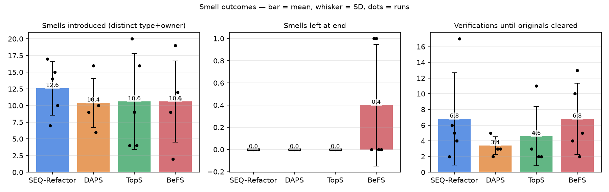
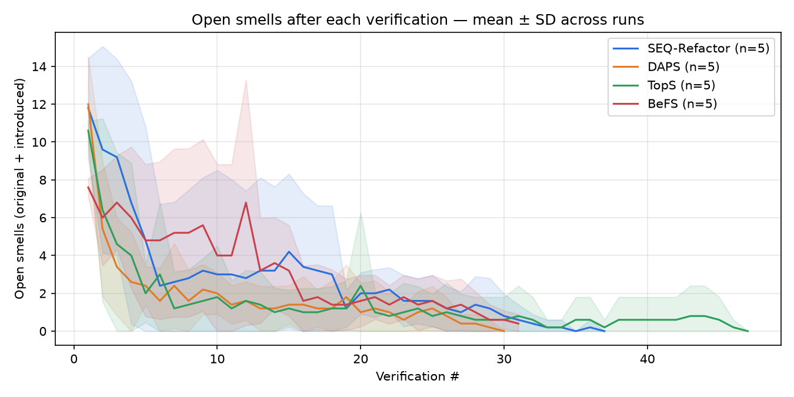
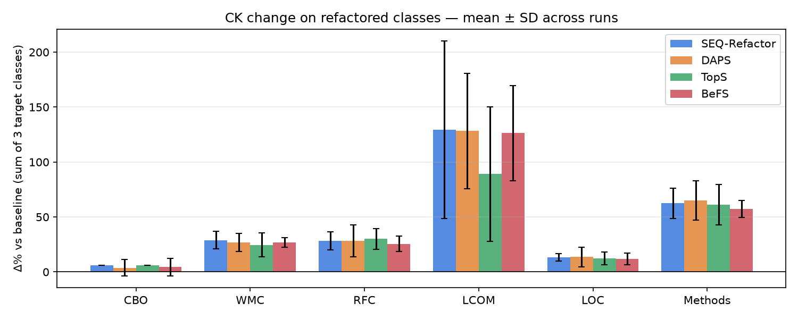
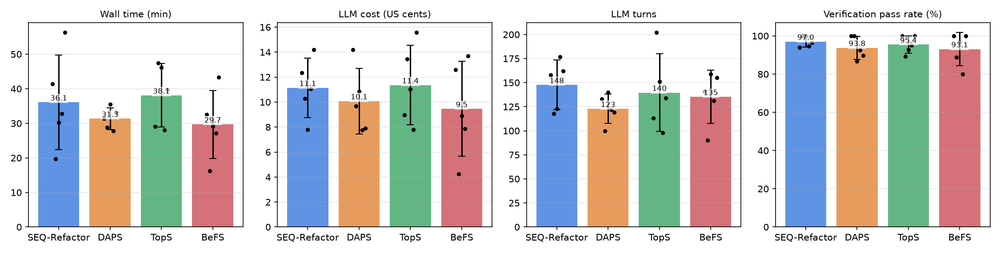
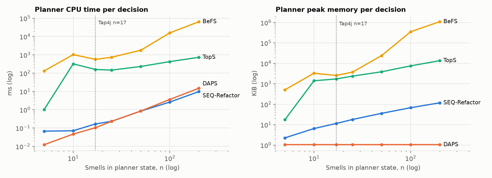

# Smell-Ordering Planner Comparison, Repeated Runs: SEQ-Refactor vs DAPS vs TopS vs BeFS

**Experiment dates:** 2026-11-12 – 2026-11-13 · **Subject:** tap4j @ `fb2451c64b4d` · **Harness:** Pi agent (`experiments/pi_batch.ts`) · **Runs:** 5 per planner, 20 in total

This document repeats the experiment in [`planner-comparison-tap4j.md`](planner-comparison-tap4j.md) (the "single-run report") five times per planner and reports averages, spread and significance tests. Its sections mirror that report. Before these runs, a harness bug that bypassed the planner for the first smell was fixed (§2.4), so the 20 runs here are **not** pooled with the single-run results.

## 1. Summary

All values are mean ± SD over 5 runs; brackets give the range.

| | SEQ-Refactor | DAPS | TopS | BeFS |
|---|---:|---:|---:|---:|
| Original smells resolved | **17/17** in 5/5 runs | **17/17** in 5/5 runs | **17/17** in 5/5 runs | **17/17** in 5/5 runs |
| Smells introduced (distinct type+owner) | 12.6 ± 4.0 [7–17] | **10.4 ± 3.6** [6–16] | 10.6 ± 7.2 [4–20] | 10.6 ± 6.1 [2–19] |
| Runs ending with zero smells | **5/5** | **5/5** | **5/5** | 3/5 |
| Verifications until originals cleared | 6.8 ± 5.9 [2–17] | **3.4 ± 1.1** [2–5] | 4.6 ± 3.8 [2–11] | 6.8 ± 4.5 [2–13] |
| LLM cost (US cents) | 11.1 ± 2.4 | 10.1 ± 2.6 | 11.4 ± 3.2 | **9.5 ± 3.8** |
| LLM turns | 148 ± 26 | **123 ± 15** | 140 ± 40 | 135 ± 28 |
| Wall time (min) | 36.1 ± 13.7 | 31.3 ± 3.2 | 38.1 ± 9.2 | **29.7 ± 9.8** |
| Verification pass rate | **97.0% ± 2.9** | 93.8% ± 6.0 | 95.4% ± 4.6 | 93.1% ± 8.6 |
| Kruskal–Wallis p (smells introduced / cost / turns) | 0.88 / 0.77 / 0.51 | | | |

Main points:

1. **No planner is significantly better on any outcome metric.** Kruskal–Wallis tests across the four planners give p ≥ 0.10 for every metric (§5.1), and no pairwise comparison survives Holm correction. The differences between planner means are smaller than the run-to-run spread inside each planner.
2. **The single-run report's headline result did not replicate.** SEQ-Refactor introduced 9 smells against 18 for DAPS in the single run. Over five runs it averaged 12.6 against 10.4, slightly *more* than DAPS. SEQ-Refactor's own runs ranged from 7 to 17 and TopS's from 4 to 20, so a 9-point gap between two single runs is well within run-to-run noise.
3. **BeFS's incompleteness is real and reproducible.** BeFS was the only planner that stopped with a smell left (`smells_exhausted`), in 2 of 5 runs, both times on one Message Chains smell, the same plateau failure as in the single run. Fisher's exact test against the other planners gives p = 0.053 on these runs alone, and p = 0.010 if the earlier BeFS run is added (§7). This is the one robust difference between planners.
4. **Ordering is visible, outcomes are not.** With the first-smell bug fixed, SEQ-Refactor, DAPS and TopS chose the Long Method first in all 15 of their runs, and BeFS chose a Feature Envy in all 5. That choice did not translate into measurable differences in smells introduced, cost or speed at this sample size.
5. **Five runs only detect large effects.** With the observed spread, a two-sample test at n = 5 per planner has 80% power only for differences of about 11 introduced smells, 6 cents or 59 turns (§9). Detecting a 3-smell difference would need roughly 50 runs per planner.

## 2. Setup

### 2.1 Planners

Unchanged from the single-run report:

| Paper name | CLI `--planner` | Implementation | Ordering principle |
|---|---|---|---|
| SEQ-Refactor | `seqrefactor` | `planning/seqrefactor.py` | Prerequisite-safe Kahn topological order; among ready smells, highest *impact* first (0.4·coupling + 0.4·severity + 0.2·co-occurrence degree), then signed-edge mass |
| DAPS | `greedy` | `planning/greedy.py` | Greedy: pick the smell whose fix is predicted to clear the most AST-related smells (positive effects only) |
| TopS | `topo` | `planning/topo.py` | Preference graph from positive, negative and unspecified rule edges; condense SCCs; enumerate up to 4,096 topological orders and pick the best-scoring one |
| BeFS | `bfs` | `planning/planner.py` | Best-first search over smell-set states using full dependency rules, minimising severity-weighted smell burden |

Every planner re-plans after each verified edit, on a fresh Spoon AST index and fresh ORGANIC detections.

### 2.2 Case

`Tap4j:462ab4c8c308` from `dataset/manifest_eval6.jsonl`: `TestTap13Consumer`, `BailOut` and `TestTap13YamlProducer`, with 17 ORGANIC smells at the start (13 Feature Envy, 3 Message Chains, 1 Long Method). The single-run report's second case (`Tap4j:4413ab35b400`, one Lazy Class) cannot separate planners and was not repeated (§8).

### 2.3 Controlled variables

- Profile `without-planning`; only the smell order differs between planners.
- Models: `deepseek/deepseek-v4-flash-0731` for attempts 1–2, `upstage/solar-pro4` from attempt 3. No smell needed a third attempt in any of the 20 runs, so **every turn ran on DeepSeek V4 Flash**.
- Thinking level high, concurrency 1, timeout 90 min per case.
- Verification after each edit: Gradle `clean test`, then ORGANIC. A step advances only when tests pass and the targeted smell is gone.
- JDK 17.0.19-tem, Gradle 8.14.3, CK at `mauricioaniche/ck@8a1ef91`.
- **Run schedule:** 5 rounds, each running every planner once, one run at a time. The planner order rotates by one position each round (round 1: DAPS, TopS, BeFS, SEQ-Refactor; round 2: TopS, BeFS, SEQ-Refactor, DAPS; …), so no planner always ran first or last, or at the same time of night.

### 2.4 Harness fix applied before these runs

In the single-run experiment, `agents/pi/hooks.py` (`_prepare`) sent the first smell in **ORGANIC detection order** and never asked the planner. The planner only chose from the second smell on. All four single-run planners therefore started on the same Feature Envy in `testConsumerHeaderPlanTrFooter`, whose fix alone cleared 10 of the 17 smells. This also means the single-run report's statement (§3.1 there) that SEQ-Refactor, DAPS and TopS "chose the Long Method first" is not accurate: that was their *second* pick.

The fix routes the first pick through the same `next_queue_smell` → `pick_next_smell` path as every later pick, and adds a regression test (`tests/test_pi_hooks.py::test_prepare_first_task_is_chosen_by_planner_not_detection_order`). Because this changes what is being measured, the single-run results are reported alongside but not averaged in.

## 3. Smells resolved and smells introduced



| Metric (mean ± SD) | SEQ-Refactor | DAPS | TopS | BeFS |
|---|---:|---:|---:|---:|
| Original smells resolved | 17 ± 0 | 17 ± 0 | 17 ± 0 | 17 ± 0 |
| Smells introduced (distinct type+owner) | 12.6 ± 4.0 | 10.4 ± 3.6 | 10.6 ± 7.2 | 10.6 ± 6.1 |
| – 95% CI | 7.6 – 17.6 | 5.9 – 14.9 | 1.7 – 19.5 | 3.0 – 18.2 |
| – per-run values | 17, 7, 14, 15, 10 | 9, 11, 16, 6, 10 | 4, 20, 9, 4, 16 | 9, 2, 19, 12, 11 |
| Introduced smells later fixed | 12.6 ± 4.0 | 10.4 ± 3.6 | 10.6 ± 7.2 | 10.2 ± 6.1 |
| Smells remaining at end | **0 in 5/5** | **0 in 5/5** | **0 in 5/5** | 0.4 ± 0.5 (1 in 2/5) |
| Methods with introduced smells | 12.4 ± 3.8 | 9.6 ± 3.0 | 9.6 ± 5.8 | 9.4 ± 4.7 |
| Smell-instance churn (distinct location hashes) | 75 ± 14 | **55 ± 10** | 72 ± 28 | 86 ± 26 |

**Counting method.** As in the single-run report: an introduced smell is counted once per logical identity (type, owning member), using the harness's own `introduced_logical_keys`. A baseline smell that disappears and later comes back is counted as introduced. Churn counts every distinct (type, owner, location) hash. All introduced smells were Feature Envy or Message Chains, except one Long Parameter List in one DAPS run.

**What the numbers show.** The spread inside each planner is larger than the gaps between planners. TopS ranged from 4 to 20 introduced smells and BeFS from 2 to 19. SEQ-Refactor's single-run result of 9 is inside its new range (7–17); DAPS's single-run 18 is just above its new range (6–16) but inside TopS's and BeFS's. No planner systematically avoided introducing smells.

### 3.1 Convergence: open smells over time



- **First pick.** SEQ-Refactor, DAPS and TopS picked the Long Method in `TestTap13YamlProducer.setUp` first in **15 of 15** runs. BeFS picked a Feature Envy first in **5 of 5** runs and **never** targeted the Long Method in any run; it was cleared as a side effect of other edits.
- **Clearing the originals.** DAPS cleared all 17 original smells fastest and most consistently (3.4 ± 1.1 verifications, at most 5). The others varied more: TopS 2–11, BeFS 2–13, SEQ-Refactor 2–17. The difference is not significant (Kruskal–Wallis p = 0.49).
- **BeFS no longer lags as in the single run.** The single run's BeFS took 24 verifications to clear the originals. Over these five runs BeFS took 6.8 ± 4.5, the same as SEQ-Refactor. The single run's 24 was an extreme draw, not typical BeFS behaviour.
- After the originals are cleared, every planner spends the rest of the run on introduced smells. The open-smell curves for all four overlap within one SD from about verification 5 onward.

### 3.2 Co-occurrence of smells

"Co-occurrence" means two or more introduced smells located in the same method.

| | SEQ-Refactor | DAPS | TopS | BeFS |
|---|---:|---:|---:|---:|
| Methods with ≥2 co-located introduced smells | **0.2 ± 0.4** | 0.8 ± 0.8 | 1.0 ± 1.7 | 1.2 ± 1.8 |
| Runs with any such method | 1/5 | 3/5 | 2/5 | 2/5 |

SEQ-Refactor had the fewest co-located introduced smells on average, in line with the single-run observation (1 against 4). The difference is not significant (Kruskal–Wallis p = 0.67; SEQ-Refactor vs DAPS Holm-adjusted p = 1.0). It is a weak signal worth checking with more runs, not a result.

## 4. Structural metrics (CK)

CK was run on each run's final worktree, excluding generated sources under `build/`. The baseline is the same clean checkout as in the single-run report.



**Sum over the three target classes** (mean ± SD; Δ% of the mean vs baseline):

| Metric | Baseline | SEQ-Refactor | DAPS | TopS | BeFS |
|---|---:|---:|---:|---:|---:|
| CBO | 32 | 34.0 ± 0.0 (+6%) | 33.2 ± 2.4 (+4%) | 34.0 ± 0.0 (+6%) | 33.4 ± 2.6 (+4%) |
| WMC | 58 | 74.8 ± 4.6 (+29%) | 73.6 ± 4.7 (+27%) | **72.2 ± 6.3 (+24%)** | 73.6 ± 2.5 (+27%) |
| RFC | 62 | 79.6 ± 5.1 (+28%) | 79.6 ± 9.0 (+28%) | 80.6 ± 5.9 (+30%) | **77.8 ± 4.3 (+25%)** |
| LCOM | 192 | 441 ± 155 (+129%) | 438 ± 101 (+128%) | **363 ± 118 (+89%)** | 435 ± 83 (+126%) |
| LOC | 303 | 342.8 ± 10.4 (+13%) | 344.6 ± 27.0 (+14%) | 340.8 ± 17.8 (+12%) | **339.4 ± 16.0 (+12%)** |
| Methods | 31 | 50.4 ± 4.3 | 51.2 ± 5.6 | 50.0 ± 5.7 | **48.8 ± 2.4** |

**Per-method complexity** in the target classes:

| Metric | Baseline | SEQ-Refactor | DAPS | TopS | BeFS |
|---|---:|---:|---:|---:|---:|
| Mean WMC per method | 1.87 | 1.49 ± 0.05 | **1.45 ± 0.09** | 1.45 ± 0.04 | 1.51 ± 0.07 |
| Mean LOC per method | 9.32 | 6.55 ± 0.41 | **6.49 ± 0.26** | 6.57 ± 0.41 | 6.67 ± 0.32 |
| Max LOC per method | 40 | **34.0 ± 0.0** | 34.6 ± 2.2 | 34.4 ± 0.5 | 35.2 ± 1.6 |

**Whole project** (124 classes, means):

| Metric | Baseline | SEQ-Refactor | DAPS | TopS | BeFS |
|---|---:|---:|---:|---:|---:|
| Mean CBO | 4.589 | 4.605 ± 0.000 | 4.603 ± 0.013 | 4.605 ± 0.000 | 4.603 ± 0.014 |
| Mean WMC | 8.298 | 8.434 ± 0.037 | 8.437 ± 0.026 | **8.413 ± 0.051** | 8.432 ± 0.022 |
| Mean LCOM | 21.28 | 23.29 ± 1.25 | 23.52 ± 0.65 | **22.66 ± 0.95** | 23.33 ± 0.74 |
| Total LOC | 4,769 | 4,809 ± 10 | 4,819 ± 13 | **4,807 ± 18** | 4,812 ± 10 |

**Interpretation.**

- **The planners leave the code in nearly the same structural state.** Every class-level mean is within one SD of every other planner's mean. All four add about 18–20 helper methods to the target classes (+57–65%) and raise WMC and RFC by 24–30%, while cutting mean method length by about 30%.
- **TopS's structural advantage shrank.** In the single run TopS had by far the smallest footprint (+2% LOC, +12% WMC, 12 added methods). Over five runs it is only slightly smaller on WMC and LCOM, and its spread overlaps everyone else's. Its single-run footprint was a favourable draw.
- **LCOM remains a poor guide.** It tracks the number of added methods in field-less test classes, so its large SDs (±83 to ±155) mostly reflect how many helpers the LLM chose to extract.
- `BailOut` (production code) was not changed in any of the 20 runs.

## 5. Execution speed and LLM cost



| Metric (mean ± SD) | SEQ-Refactor | DAPS | TopS | BeFS |
|---|---:|---:|---:|---:|
| Wall time (min) | 36.1 ± 13.7 | 31.3 ± 3.2 | 38.1 ± 9.2 | **29.7 ± 9.8** |
| Cost (US cents) | 11.1 ± 2.4 | 10.1 ± 2.6 | 11.4 ± 3.2 | **9.5 ± 3.8** |
| LLM turns | 148 ± 26 | **123 ± 15** | 140 ± 40 | 135 ± 28 |
| Input / output tokens (k) | 374 / 136 | 341 / 121 | 385 / 139 | **290 / 113** |
| Cache-read tokens (k) | 1,168 | 1,114 | 1,159 | 1,089 |
| Verifications (Gradle + ORGANIC) | 30.2 ± 5.2 | **25.8 ± 4.4** | 28.2 ± 11.0 | 26.8 ± 5.4 |
| Verifications passed | 29.2 ± 4.4 | 24.0 ± 2.9 | 26.6 ± 9.1 | 25.0 ± 5.8 |
| Pass rate | **97.0% ± 2.9** | 93.8% ± 6.0 | 95.4% ± 4.6 | 93.1% ± 8.6 |
| Tests failed after an edit | **1.0 ± 1.0** | 1.8 ± 1.8 | 1.6 ± 2.1 | 1.8 ± 2.5 |
| Tests passed but target smell still present | 0.8 ± 0.8 | 1.0 ± 1.4 | 1.0 ± 1.7 | **0.6 ± 0.9** |
| Planner invocations | 23.8 ± 4.6 | **18.2 ± 3.0** | 20.2 ± 7.3 | 20.6 ± 5.3 |

- **Cost and time vary more within a planner than between planners.** SEQ-Refactor's wall time ranged from 19.7 to 56.3 min and BeFS's cost from 4.2 to 13.7 cents. The cheapest single run (BeFS, 4.2 ¢) was one that stopped early with a smell left.
- **DAPS was the most consistent**, with the smallest SD on wall time (±3.2 min), turns (±15) and verifications to clear the originals (±1.1). Being consistent is not the same as being better on average; its means are not significantly different from the others.
- **SEQ-Refactor had the highest pass rate and fewest failed-test edits** on average, again within noise (pass rate Kruskal–Wallis p = 0.85).
- The whole experiment (20 runs) cost **$2.10** in LLM fees and about **11.3 hours** of wall time.

### 5.1 Significance tests

Kruskal–Wallis test across the four planners (5 runs each), then two-sided Mann–Whitney U tests for each of the 6 planner pairs with Holm–Bonferroni correction. Effect size is Cliff's δ (−1 to +1; |δ| ≥ 0.47 is conventionally "large").

| Metric | Kruskal–Wallis H | p | Smallest Holm-adjusted pairwise p | Largest |δ| (pair) |
|---|---:|---:|---:|---|
| Smells introduced | 0.66 | 0.884 | 1.00 | 0.32 (SEQ-Refactor > DAPS) |
| Smells left at end | 6.33 | 0.096 | 1.00 | 0.40 (BeFS > each other) |
| Verifications to clear originals | 2.40 | 0.494 | 1.00 | 0.48 (SEQ-Refactor, BeFS > DAPS) |
| LLM cost | 1.13 | 0.771 | 1.00 | 0.36 (SEQ-Refactor > DAPS) |
| LLM turns | 2.29 | 0.514 | 1.00 | 0.52 (SEQ-Refactor > DAPS) |
| Wall time | 2.06 | 0.559 | 1.00 | 0.44 (TopS > DAPS, TopS > BeFS) |
| Verification pass rate | 0.79 | 0.853 | 1.00 | 0.36 (SEQ-Refactor > DAPS) |
| Verifications | 1.88 | 0.597 | 1.00 | 0.44 (SEQ-Refactor > DAPS, TopS) |
| Methods with ≥2 introduced smells | 1.55 | 0.672 | 1.00 | 0.44 (DAPS > SEQ-Refactor) |

No metric reaches p < 0.05. A few pairs show large effect sizes, most often DAPS needing fewer turns and verifications than SEQ-Refactor, but with 5 runs each these are not distinguishable from chance. Full results: `figures/planner-comparison-repeated/significance.json`.

## 6. Time and space complexity of the planning algorithms

Unchanged. Planner complexity does not depend on the LLM, so the analysis and benchmark from the single-run report (§6 there) still apply. The figure and raw data are copied into this report's figure folder.



| n | DAPS | SEQ-Refactor | TopS | BeFS |
|---:|---:|---:|---:|---:|
| 17 (Tap4j size) | 0.10 ms / 1 KiB | 0.17 ms / 12 KiB | 159 ms / 1.7 MiB | 565 ms / 2.5 MiB |
| 200 | 14.9 ms / 1 KiB | **9.8 ms** / 118 KiB | 732 ms / 13 MiB | **64.8 s / 1.05 GiB** |
| Fitted time exponent, 50→200 | n^2.07 | n^1.77 | n^0.83 (capped) | n^2.60 |

At Tap4j's size every planner's own computation is negligible next to the Spoon AST re-index and each edit cycle (LLM turns plus Gradle + ORGANIC verification), which averaged 1.1–1.4 min per verification across planners. BeFS's super-polynomial growth only matters on larger projects.

## 7. Correctness and robustness

| Property | SEQ-Refactor | DAPS | TopS | BeFS |
|---|---|---|---|---|
| Finished with zero smells | 5/5 | 5/5 | 5/5 | **3/5** |
| Always returns a smell when smells remain | Yes, except smells inside a prerequisite cycle | Yes | Yes | **No** |
| Deterministic given identical smell IDs | Yes | Yes | Yes | Yes |

**BeFS failure, reproduced.** Both BeFS runs that stopped early (`01a1d288…`, `01a1d2c4…`) ended with exactly one open smell, a Message Chains in `TestTap13Consumer` (line 90 and line 92), and stop reason `smells_exhausted`. This is the same failure as in the single run: the Message Chains rule has no positive effects and one predicted introduction (a Data Class), so for a state holding only that smell no successor lowers the burden, and BeFS returns an empty plan. Counting the single run's BeFS run too, BeFS stalled in **3 of 6** runs while the other planners stalled in **0 of 18** (Fisher's exact p = 0.010; on the 20 new runs alone, 2 of 5 vs 0 of 15, p = 0.053). The harness fix in §2.4 only changes the first pick, so it does not affect this failure, which makes pooling the BeFS runs for this one comparison reasonable.

**SEQ-Refactor still degenerates on this case.** All 17 smells are method-scoped, so SEQ-Refactor derives no containment prerequisites and its order reduces to severity first, then smell ID. Its consistent first pick (the HIGH-severity Long Method) comes from the severity term, not from prerequisite safety. This case does not exercise SEQ-Refactor's distinguishing property.

**Tie-breaking remains non-reproducible.** Smell IDs hash the absolute path of a checkout folder with a random name (`smell/smell.py`, `repository/repo.py`), so after the first pick the order of tied smells differs from run to run for every planner. This was not changed: it is a source of the run-to-run variance measured here. The order-only Kendall τ comparison (§7.1 of the single-run report) was not repeated for that reason.

## 8. The LangGraph command on `Tap4j:4413ab35b400`

Not repeated. That case has one smell in scope, so all four planners pick the same smell and the outcome depends only on the LLM (single-run report, §8). Repeating it would measure LLM variance, not planner differences.

## 9. Threats to validity

1. **Five runs per planner have low power.** Using the pooled SDs observed here, a two-sample comparison at n = 5, α = 0.05 and 80% power only detects differences of about **11 introduced smells, 6 cents or 59 LLM turns**, larger than any gap observed. "No significant difference" here means "no large difference", not "no difference". Detecting a 3-smell difference in introduced smells would need about 50 runs per planner.
2. **One project, one case, test-code smells.** All 17 starting smells are method-level and 16 are in test classes. SEQ-Refactor's prerequisite ordering and TopS's SCC handling barely engage, so this case is a weak test of what distinguishes the planners. The six-case `manifest_eval6` set, which includes class-level smells, is a better test bed.
3. **Run-to-run variance has several sources:** LLM sampling, the random tie-breaking in §7, and ORGANIC re-detection. This experiment does not separate them. Fixing the tie-break (hashing repo-relative paths) would remove one source and make planner differences easier to see.
4. **Wall time depends on external latency.** Runs went one at a time overnight, so they did not compete for CPU, but OpenRouter latency varies with time of day. Rotating the planner order spreads this evenly across planners but does not remove it from the SDs.
5. **The detector drives the metric.** "Introduced" means what ORGANIC reports, including smells triggered by the agent's own extracted helper methods.
6. **The harness changed between the single run and these runs** (§2.4), so the two sets are compared side by side, not pooled. The one exception is BeFS's plateau failure (§7), which the change does not touch.

## 10. Scorecard

"≈" means the differences are within noise (no significant test result).

| Criterion | Result over 5 runs | Single-run verdict | Holds up? |
|---|---|---|---|
| Original smells resolved | All 17/17 in every run | tie | Yes |
| Fewest smells introduced | ≈ (DAPS 10.4, TopS 10.6, BeFS 10.6, SEQ-Refactor 12.6; p = 0.88) | SEQ-Refactor (9 vs 16–18) | **No** |
| Finished with zero smells | SEQ-Refactor, DAPS, TopS (5/5); BeFS 3/5 | BeFS failed | **Yes** (p = 0.010 pooled) |
| Speed of convergence on originals | ≈ (DAPS 3.4 most consistent; p = 0.49) | BeFS slowest (24 vs 2) | **No** |
| LLM cost | ≈ (9.5–11.4 ¢; p = 0.77) | DAPS cheapest | No difference |
| LLM turns | ≈ (DAPS 123 fewest; p = 0.51) | SEQ-Refactor fewest | **No** |
| Wall time | ≈ (29.7–38.1 min; p = 0.56) | within noise | Yes (still noise) |
| Edit quality (pass rate) | ≈ (SEQ-Refactor 97.0% highest; p = 0.85) | TopS highest | **No** |
| Structural footprint (CK) | ≈ (TopS slightly smallest on WMC/LCOM) | TopS clearly smallest | Only weakly |
| Fewest co-located new smells | ≈ (SEQ-Refactor 0.2 vs 0.8–1.2; p = 0.67) | SEQ-Refactor | Weak signal only |
| Planner time / space complexity | Unchanged (DAPS ≈ SEQ-Refactor best; BeFS worst) | same | Yes (no LLM involved) |
| Completeness and robustness | BeFS incomplete on burden plateaus | same | **Yes** |

**Recommendation.** On this case, **the choice among SEQ-Refactor, DAPS and TopS does not measurably change the outcome**: all three always cleared every smell, and their cost, speed, edit quality and structural footprint are statistically indistinguishable. Choose among them on algorithmic grounds. DAPS and SEQ-Refactor are the cheapest to compute and scale best; DAPS also had the most consistent runs. **BeFS should not be used as-is**: it is the only planner that fails to finish, it fails in about half its runs on this case, and it scales worst. The rankings in the single-run report, including SEQ-Refactor's halving of introduced smells, should not be cited. To find real differences between the first three planners, the next experiment should (1) fix the tie-break so smell IDs are stable, (2) use cases with class-level smells where prerequisite ordering matters, and (3) plan for far more runs per planner (on the order of 50 for 3-smell effects), or use paired designs that reduce LLM variance.

## 11. Reproducing

```bash
# OPENROUTER_API_KEY in the gitignored mise.local.toml ([env] section); pi_batch.ts loads it.

# 20 runs: 5 rounds x 4 planners, rotated order, one at a time (~11 h, ~$2)
./experiments/run_repeated_tap4j.sh          # ROUNDS=5 by default; resumable
# run IDs are appended to data/pi/repeated/tap4j_runs.tsv

# Per-run metrics and aggregates (mean, SD, 95% CI)
uv run python -m experiments.aggregate_planner_runs \
  --run-ids $(cut -f3 data/pi/repeated/tap4j_runs.tsv) \
  --out docs/figures/planner-comparison-repeated/runs.json

# Figures and significance tests (scipy is pulled in only for this step)
uv run --with scipy python -m experiments.plot_planner_runs \
  --runs docs/figures/planner-comparison-repeated/runs.json \
  --baseline-ck docs/figures/planner-comparison/results.json \
  --out-dir docs/figures/planner-comparison-repeated
```

`experiments.aggregate_planner_runs` was checked against the single-run report: run on the four original logs, it reproduces every metric there (introduced smells by type, owner and co-location; churn; cost; turns; tokens; verification counts; verifications to clear the originals; all CK tables).

The data is in `docs/figures/planner-comparison-repeated/`:
- `runs.json`: per-run metrics, timelines, CK results and the per-planner aggregates
- `significance.json`: Kruskal–Wallis and pairwise Mann–Whitney results with Holm-adjusted p and Cliff's δ
- `bench.json`, `fig5_planner_scaling.png`: copied from the single-run report

Raw logs are in `data/pi/runs/tupilabs_tap4j/<run-id>/` (gitignored). Run IDs:

| Round | DAPS | TopS | BeFS | SEQ-Refactor |
|---:|---|---|---|---|
| 1 | `01a1d1e1…` | `01a1d1fe…` | `01a1d218…` | `01a1d237…` |
| 2 | `01a1d2aa…` | `01a1d25d…` | `01a1d288…` † | `01a1d297…` |
| 3 | `01a1d2fb…` | `01a1d31c…` | `01a1d2c4…` † | `01a1d2df…` |
| 4 | `01a1d365…` | `01a1d37e…` | `01a1d398…` | `01a1d346…` |
| 5 | `01a1d3b1…` | `01a1d3d0…` | `01a1d3f4…` | `01a1d41c…` |

† Stopped with `smells_exhausted` (one Message Chains smell left).
