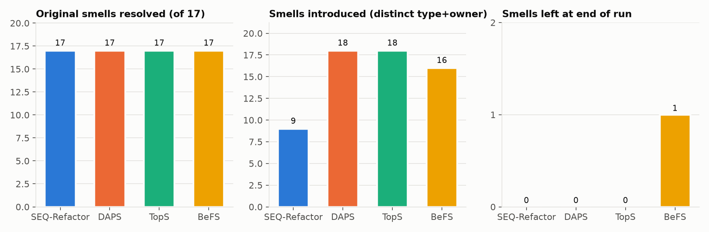
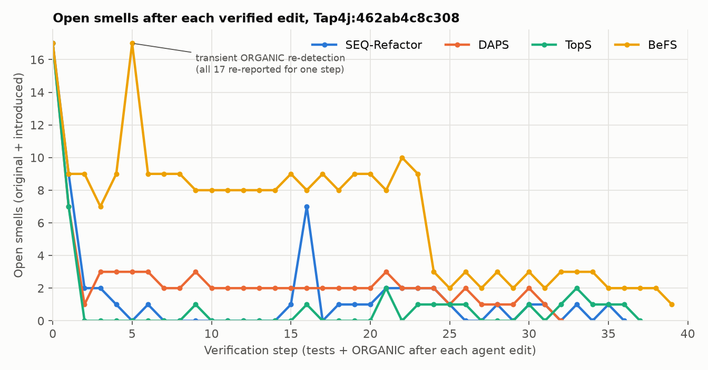
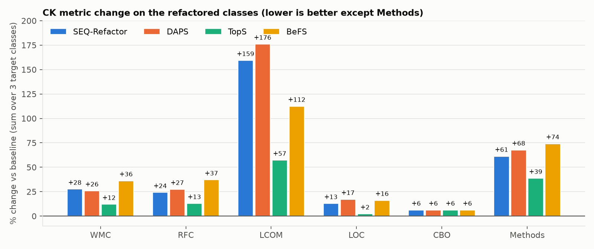
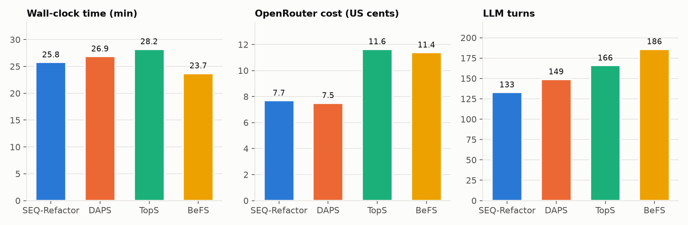
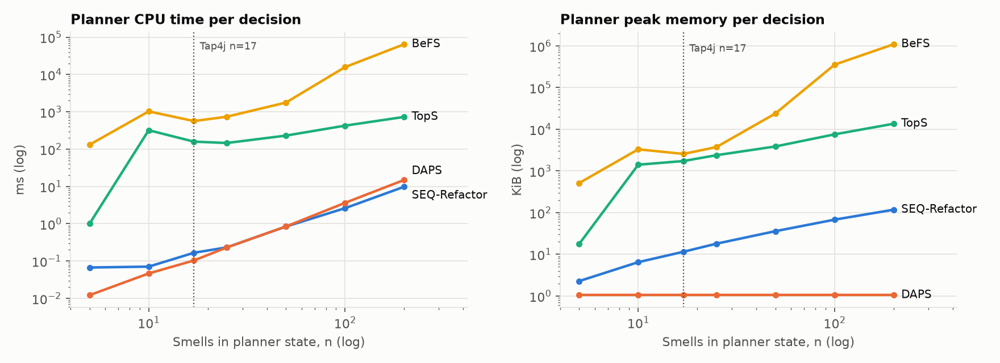

# Smell-Ordering Planner Comparison: SEQ-Refactor vs DAPS vs TopS vs BeFS

**Experiment date:** 2026-11-06 · **Subject:** tap4j @ `fb2451c64b4d` · **Harness:** Pi agent (`experiments/pi_batch.ts`) + LangGraph (`experiments.main`)

## 1. Summary

All four planners led the agent to resolve **all 17 original smells** on `Tap4j:462ab4c8c308`, with tests passing at the end. They differed in what happened along the way:

| | SEQ-Refactor | DAPS | TopS | BeFS |
|---|---:|---:|---:|---:|
| Original smells resolved | **17/17** | **17/17** | **17/17** | **17/17** |
| Smells introduced (distinct type+owner) | **9** | 18 | 18 | 16 |
| Smells left at end | **0** | **0** | **0** | 1 |
| Run outcome | cleared | cleared | cleared | `smells_exhausted` |
| Verified edits to clear all originals | **2** | **2** | **2** | 24 |
| LLM cost (US cents) | 7.7 | **7.5** | 11.6 | 11.4 |
| LLM turns | **133** | 149 | 166 | 186 |
| Wall time (min) | 25.8 | 26.9 | 28.2 | **23.7** |
| Test pass rate across verifications | 88.9% | 84.4% | **97.3%** | 89.7% |
| Planner CPU per decision at n=17 | 0.17 ms | **0.10 ms** | 159 ms | 565 ms |
| Asymptotic time per decision | O(n² + E log n) | O(n²) | O(n² + K·(n+E)) | O(X·n²) |
| Lowest CK growth on target classes | – | – | **yes** | – |

Main points:

1. **SEQ-Refactor introduced the fewest new smells:** 9, against 16–18 for the others. It also had the fewest co-located new smells: 1 method, against 4 for each of the others. It used the fewest LLM turns.
2. **BeFS was the weakest planner.** It is the only one that did not finish. It deferred the Long Method to the end, so 7 original smells stayed open for 24 verified edits instead of 2. Its search grows super-polynomially in time and memory (65 s and 1.1 GB per decision at n=200).
3. **DAPS was the cheapest per decision and per dollar.** TopS left the target classes structurally closest to the baseline, with the smallest growth in WMC, RFC, LCOM and LOC, and had the highest test pass rate.
4. **Each planner ran once.** LLM non-determinism is large compared to the gaps measured here. Treat the differences as observations from one run, not statistically significant results (see §9).

## 2. Setup

### 2.1 Planners

| Paper name | CLI `--planner` | Implementation | Ordering principle |
|---|---|---|---|
| SEQ-Refactor | `seqrefactor` | `planning/seqrefactor.py` | Prerequisite-safe Kahn topological order; among ready smells, highest *impact* first (0.4·coupling + 0.4·severity + 0.2·co-occurrence degree), then signed-edge mass |
| DAPS | `greedy` | `planning/greedy.py` | Greedy: pick the smell whose fix is predicted to clear the most AST-related smells (positive effects only; negative effects ignored) |
| TopS | `topo` | `planning/topo.py` | Build a preference graph from positive, negative and unspecified rule edges, condense its SCCs, enumerate up to 4,096 topological orders, and pick the one with the best distance + vertex score |
| BeFS | `bfs` | `planning/planner.py` | Best-first search over planner states (sets of smells) using full dependency rules, including predicted smell introductions; minimises severity-weighted smell burden |

Every planner re-plans after each verified edit. In each re-plan, it re-runs the Spoon AST indexer on the edited code and receives the fresh ORGANIC detections.

### 2.2 Cases

| Case | Scope | ORGANIC smells at start | Purpose |
|---|---|---|---|
| `Tap4j:462ab4c8c308` (`manifest_eval6.jsonl`) | `TestTap13Consumer`, `BailOut`, `TestTap13YamlProducer` | 17: 13 Feature Envy, 3 Message Chains, 1 Long Method | **Main comparison** (Pi harness, with CK metrics) |
| `Tap4j:4413ab35b400` (`manifest.jsonl`) | 5 elements around `TapElement` | 1: Lazy Class | The requested `experiments.main` command (LangGraph harness) |

The second case has only one smell, so every planner orders it the same way. Differences between its runs come from the LLM, not from the planner (§8).

### 2.3 Controlled variables (Pi harness)

- Profile: `without-planning`. The agent itself gets no planning prompt; only the ordering differs.
- Models: `deepseek/deepseek-v4-flash-0731` for attempts 1–2, and `upstage/solar-pro4` from attempt 3. In practice no smell needed a third attempt, so **every planner ran entirely on DeepSeek V4 Flash**, and the model is held constant.
- Thinking level: high. Concurrency: 1. Timeout: 90 min per case.
- Verification after each edit: Gradle `clean test`, then ORGANIC. A step advances only if the tests pass and the targeted smell is gone.
- Environment: JDK 17.0.19-tem (Temurin), Gradle 8.14.3, CK at `mauricioaniche/ck@8a1ef91`.

## 3. Smells resolved and smells introduced



| Metric | SEQ-Refactor | DAPS | TopS | BeFS |
|---|---:|---:|---:|---:|
| Original smells resolved | 17 | 17 | 17 | 17 |
| Smells introduced (distinct type+owner) | **9** | 18 | 18 | 16 |
| – of which Feature Envy | 7 | 12 | 14 | 11 |
| – of which Message Chains | 2 | 6 | 4 | 5 |
| Introduced smells later fixed | 9 | 18 | 18 | 15 |
| Total smells resolved (original + introduced) | 26 | 35 | 35 | 32 |
| Smells remaining at end | **0** | **0** | **0** | 1 (Message Chains in `assertBailOuts`) |
| Smell-instance churn (distinct location hashes seen as introduced) | 88 | **52** | 78 | 135 |

**Counting method.** The harness counts an introduced smell once per *logical* identity, meaning its (type, owning method) pair. A smell that moves because lines shifted is therefore not counted twice. "Churn" counts every distinct (type, owner, location) hash, so it also captures how much the code around the smells moved during the run.

**What the numbers show.** Each introduced smell costs another LLM refactoring cycle. SEQ-Refactor introduced half as many smells as DAPS or TopS, so its agent did 26 smell resolutions in total, against 35 for DAPS and TopS. All introduced smells are the same two types as the baseline: Feature Envy and Message Chains, in the two test classes. They come from refactorings that extract helper methods. A new helper that calls accessors on another class can itself be flagged as Feature Envy or Message Chains.

### 3.1 Convergence: open smells over time



This figure shows the clearest effect of ordering in the experiment:

- **SEQ-Refactor, DAPS and TopS** all chose the **Long Method** in `TestTap13YamlProducer.setUp` first. With that fix and one follow-up edit, all original smells were cleared by **verified edit 2**. After that, these planners only handled introduced smells, which stayed at 0–3 open.
- **BeFS** chose Feature Envy instances first and left the Long Method until the end of its order. The 7 original smells around it stayed open until **verified edit 24**, and BeFS's open-smell count stayed at 8–10 for most of the run.

The Long Method rule has positive effects on Feature Envy, so fixing it first clears related smells too. DAPS and TopS score this effect directly. SEQ-Refactor reaches the same choice through its severity-based impact score. BeFS ranks by predicted *burden reduction*, and its rules also predict that fixing a Long Method *introduces* Message Chains and Long Parameter List smells. That prediction pushes the Long Method down its order.

The single spike to 17 in the BeFS line (step 5) is a transient ORGANIC re-detection, where all original smells were re-reported for one passed verification. It is real logged data and does not affect the final counts.

### 3.2 Co-occurrence of smells

"Co-occurrence" here means two or more smells located in the same method.

| | Baseline | SEQ-Refactor | DAPS | TopS | BeFS |
|---|---:|---:|---:|---:|---:|
| Methods with ≥1 smell | 13 | – | – | – | – |
| Methods with ≥2 co-located smells | 4 (Feature Envy + Message Chains) | – | – | – | – |
| Methods with introduced smells | – | **8** | 14 | 14 | 12 |
| …of which with ≥2 co-located introduced smells | – | **1** | 4 | 4 | 4 |

SEQ-Refactor's new smells were spread more thinly. Only one method gained more than one new smell, against four for each of the other planners. At the end of the run, every planner except BeFS had **zero** co-located smells. BeFS ended with one lone Message Chains smell.

## 4. Structural metrics (CK)

CK was run on the clean baseline and on each planner's final worktree. Generated sources under `build/` were excluded from all five. The three target classes are where all the edits happened.



**Sum over the three target classes** (Δ% vs baseline):

| Metric | Baseline | SEQ-Refactor | DAPS | TopS | BeFS |
|---|---:|---:|---:|---:|---:|
| CBO (coupling) | 32 | 34 (+6%) | 34 (+6%) | 34 (+6%) | 34 (+6%) |
| WMC (complexity) | 58 | 74 (+28%) | 73 (+26%) | **65 (+12%)** | 79 (+36%) |
| RFC (response set) | 62 | 77 (+24%) | 79 (+27%) | **70 (+13%)** | 85 (+37%) |
| LCOM (lack of cohesion) | 192 | 498 (+159%) | 530 (+176%) | **302 (+57%)** | 408 (+112%) |
| LOC | 303 | 342 (+13%) | 355 (+17%) | **310 (+2%)** | 352 (+16%) |
| Methods | 31 | 50 | 52 | **43** | 54 |

**Per-method complexity** in the target classes (lower is better):

| Metric | Baseline | SEQ-Refactor | DAPS | TopS | BeFS |
|---|---:|---:|---:|---:|---:|
| Mean WMC per method | 1.87 | 1.48 | **1.40** | 1.51 | 1.46 |
| Mean LOC per method | 9.32 | 6.56 | 6.56 | 6.88 | **6.26** |
| Max LOC per method | 40 | 34 | 34 | **32** | 34 |

**Whole project** (124 classes, means):

| Metric | Baseline | SEQ-Refactor | DAPS | TopS | BeFS |
|---|---:|---:|---:|---:|---:|
| Mean CBO | 4.589 | 4.605 | 4.605 | 4.605 | 4.605 |
| Mean WMC | 8.298 | 8.427 | 8.419 | **8.363** | 8.468 |
| Mean LCOM | 21.28 | 23.75 | 24.01 | **22.34** | 23.02 |
| Total LOC | 4,769 | 4,808 | 4,821 | **4,781** | 4,818 |

**Interpretation.**

- **Complexity was redistributed into smaller methods, not removed.** Every planner reduced the average and maximum method size and complexity: method LOC fell 26–33% and the longest method shrank from 40 to 32–34 lines. Class totals for WMC and RFC rose, because Feature Envy and Long Method fixes in test classes extract helper methods. That is the expected result of these refactorings, not a regression.
- **LCOM is a poor guide here.** CK's LCOM counts pairs of methods that share no fields, so it grows roughly with the square of the method count. Adding about 20 helper methods to `TestTap13Consumer`, which has almost no fields, mechanically raises LCOM by 100–340. Read the LCOM row as a proxy for how many methods were added.
- **TopS made the smallest structural change** on every class-level metric, with +2% LOC and +12% WMC. It reached the same smell outcome with the fewest added methods (12, against 19–23).
- **CBO rose by exactly +1** on each test class under every planner, so the cause is shared by all runs and not specific to any planner.
- `BailOut` (production code) was not changed by any planner.

## 5. Execution speed and LLM cost



| Metric | SEQ-Refactor | DAPS | TopS | BeFS |
|---|---:|---:|---:|---:|
| Wall time (min) | 25.8 | 26.9 | 28.2 | **23.7** |
| Cost (USD) | 0.0769 | **0.0750** | 0.1165 | 0.1139 |
| LLM turns | **133** | 149 | 166 | 186 |
| Input / output tokens | 338k / 93k | 323k / 88k | 318k / 138k | 450k / 140k |
| Cache-read tokens | 751k | 845k | 1,438k | 1,086k |
| Verifications (Gradle + ORGANIC) | 36 | 32 | 37 | 39 |
| Verifications passed | 32 (88.9%) | 27 (84.4%) | **36 (97.3%)** | 35 (89.7%) |
| Tests failed after an edit | 4 | 5 | **1** | 4 |
| Tests passed but target smell still present | **1** | 2 | 3 | 2 |
| Mean min per verification | 0.72 | 0.84 | 0.76 | **0.61** |
| Planner invocations (AST re-index + decide) | 23 | 23 | 25 | 30 |
| Cost per smell resolved (US cents) | 0.296 | **0.214** | 0.333 | 0.356 |

- **Wall time is dominated by verification**, about 0.6–0.85 min per Gradle + ORGANIC cycle, not by planning. BeFS was fastest in total despite the most verifications, because its test runs were the quickest on average. The four wall times are within ±10% of each other, which is likely within run-to-run noise.
- **Cost depends on how many edits are needed**, which in turn depends on how many smells get introduced. SEQ-Refactor and DAPS cost the same (≈7.6 ¢). TopS and BeFS cost about 50% more: TopS through its long output-heavy turns, and BeFS because it took the most turns.
- **TopS had the cleanest edits**, with a 97.3% pass rate and only 1 test failure. That fits its smaller structural footprint in §4.

## 6. Time and space complexity of the planning algorithms

Notation: *n* is the number of smells in the planner state, *E* the number of preference or dependency edges between smells (≤ n²), *d* the AST relation lookup cost (O(1) hash-set lookup), *K* = 4,096 the TopS enumeration cap, and *X* = 10,000 the BeFS expansion cap.

### 6.1 Analysis

| Planner | Time per decision | Extra space | Notes |
|---|---|---|---|
| **DAPS** | **O(n²)**: for each smell, scan all others for related smells with positive effects | **O(1)** beyond the input | Ignores negative effects, so it never predicts introductions |
| **SEQ-Refactor** | **O(n²·L + (n+E) log n)**: pairwise containment checks (string prefix of length L), then a heap-based Kahn traversal; cyclic SCCs set aside in O(n+E) | O(n + E) | Complete and deterministic. Every smell not in a cycle gets ordered |
| **TopS** | **O(n² + K·(n+E))**: build the preference graph, condense SCCs, enumerate ≤ K topological orders and score each. Without the cap, worst case O(n!·n) | O(n² + K·n) | The cap makes it bounded but approximate. With many independent smells, only a slice of the valid orders is examined |
| **BeFS** | **O(X·n²·log X)**: up to X expansions; each generates ≤ n transitions, and each transition applies a rule in O(n). The underlying state space is up to 2ⁿ smell subsets plus predicted introductions | **O(X·n·p)**: every heap entry stores a full state and path (p = path length) | Incomplete: returns an empty plan when no path lowers the burden (see §7) |

Every planner also re-runs the **Spoon AST indexer** (Gradle) on each invocation. On tap4j the index has 727 elements and 1,889 edges. The indexer costs seconds per call, the same for all planners, and costs far more than any planner's own computation at this scale.

### 6.2 Empirical measurement

Each planner's core function was timed on synthetic states with n = 5…200: ORGANIC smell types, about 6 smells per class, 4 methods per class, and 2 random call edges per method. Timings are the best of several repetitions; peak memory comes from `tracemalloc`.



| n | DAPS | SEQ-Refactor | TopS | BeFS |
|---:|---:|---:|---:|---:|
| 17 (Tap4j size) | 0.10 ms / 1 KiB | 0.17 ms / 12 KiB | 159 ms / 1.7 MiB | 565 ms / 2.5 MiB |
| 50 | 0.84 ms / 1 KiB | 0.84 ms / 36 KiB | 231 ms / 3.8 MiB | 1.8 s / 23 MiB |
| 100 | 3.6 ms / 1 KiB | 2.6 ms / 68 KiB | 426 ms / 7.4 MiB | 15.8 s / 348 MiB |
| 200 | 14.9 ms / 1 KiB | **9.8 ms** / 118 KiB | 732 ms / 13 MiB | **64.8 s / 1.05 GiB** |
| Fitted exponent of time, 50→200 | n^2.07 | n^1.77 | n^0.83 (capped) | n^2.60 |
| Fitted exponent of memory, 50→200 | n^0 | n^0.86 | n^0.91 | n^2.76 |

The measured growth matches the analysis. DAPS is quadratic in time with constant memory. SEQ-Refactor is sub-quadratic in practice with linear memory, and is the fastest at n ≥ 100. TopS is flat because its K-cap dominates. BeFS grows super-polynomially in both time and memory: one decision at n = 200 takes about a minute and a gigabyte. On larger projects, re-planning after each edit with BeFS would become a bottleneck.

## 7. Correctness and robustness

| Property | SEQ-Refactor | DAPS | TopS | BeFS |
|---|---|---|---|---|
| Always returns a smell when smells remain | Yes, except smells inside a prerequisite cycle | Yes | Yes | **No** |
| Uses negative (introduction) rules | Yes, as signed-edge tie-break | No | Yes, as preference edges | Yes, in the search objective |
| Handles dependency cycles | Escalates the SCC and skips it | n/a | Condenses SCCs and orders members by weight | n/a, state-space search |
| Deterministic | Yes | Yes | Yes | Yes |

**BeFS failure, root cause.** In the BeFS run, the last open smell was a Message Chains smell in `TestTap13Consumer.assertBailOuts`. The rule for Message Chains has no positive effects and one negative effect: it predicts that fixing the smell introduces a Data Class. For a state holding only that smell, every successor state has the same or higher severity-weighted burden as the start. BeFS then returns an empty plan, and the harness stops with `smells_exhausted`. This was reproduced directly: `best_first_smell_plan((lone Message Chains,), organic_rules, …)` returns `[]`. The same gap appears without any LLM: in the order-only comparison, BeFS ordered only 16 of the 17 baseline smells.

**SEQ-Refactor degenerates on this case.** All 17 smells are method-scoped, and SEQ-Refactor builds its edges only from class→member containment. So it derived **0 dependency edges**, and its ordering reduced to the impact score. In that score, the coupling term is constant (normalised to 0) and the co-occurrence term is 0, so the order is effectively **severity first, then smell ID**. The smell ID is not stable across runs (see §7.1), so after the Long Method the order of SEQ-Refactor's picks is arbitrary. Its advantage on introduced smells therefore cannot come from enforcing prerequisites, because there were none, and it cannot be credited to a systematic tie-break either. LLM variance and tie order are the likely explanations. This case does not exercise SEQ-Refactor's prerequisite-safety property.

### 7.1 Ordering agreement on the fixed baseline (no LLM)

`experiments.compare_ordering` asks each planner for its full ranking of the 17 baseline smells, without editing any code. **This comparison is not reproducible.** The same command, run four times on the same commit, gave four different sets of Kendall τ values:

| Run | DAPS τ | TopS τ | BeFS τ (16 shared) |
|---|---:|---:|---:|
| Earlier note, `docs/seqrefactor-tap4j-ordering.md` | 0.794 | 0.750 | 0.067 |
| Re-run A (first version of this document) | 0.456 | 0.529 | −0.233 |
| Re-run B | 0.412 | 0.471 | −0.350 |
| Re-run C | 0.618 | 0.868 | −0.033 |
| **Range** | **0.41 – 0.79** | **0.47 – 0.87** | **−0.35 – +0.07** |

**Cause.** A smell's ID is a SHA-256 hash that includes its file URI (`smell/smell.py`, `_identity_digest`). Every run checks the code out into a new worktree folder whose name contains a fresh UUID (`repository/repo.py`, `worktree_path`). So every smell gets a new ID on every run. After the Long Method, most of the 17 smells tie on every planner's score, and all four planners break ties by smell ID. The order of the tied smells is therefore effectively random, and τ varies with it. `PYTHONHASHSEED=0` does not help, because the variation comes from the path, not from Python's hash seed. No single τ value is the correct one, and none should be reported as a point estimate.

**What held in all four runs:**

- SEQ-Refactor, DAPS and TopS always pick the Long Method (`TestTap13YamlProducer.setUp`) first.
- BeFS always orders only 16 of the 17 smells, always starts with Feature Envy and always puts the Long Method last. Its τ against SEQ-Refactor is always the lowest, and is at or below zero in three of the four runs.
- DAPS and TopS always agree with SEQ-Refactor far more than BeFS does (τ ≥ 0.41).

The same tie-breaking applies inside the agent runs (§3–§5), so the order of their tied picks was also arbitrary. Each agent run also re-detects smells and re-indexes the AST after every edit, so a planner's later choices differ from this static agenda in any case. To make the order-only comparison reproducible, hash a path relative to the repository root instead of the absolute URI.

## 8. The requested command: `experiments.main` on `Tap4j:4413ab35b400`

The requested command (`uv run python -m experiments.main --case-id "Tap4j:4413ab35b400"`) was run once per planner via `PLANNING_PLANNER`. This uses the LangGraph workflow with `qwen/qwen3.7-flash`, which records no CK metrics or cost.

| Planner | Outcome | Steps | LLM calls | Tokens | Wall time |
|---|---|---:|---:|---:|---:|
| DAPS | `no_progress`: Lazy Class still present after 3 steps | 3 | 43 | 247,603 | 483 s |
| TopS | `smells_cleared` | 1 | 19 | 111,941 | 204 s |
| BeFS | `smells_cleared` | 1 | 19 | 104,874 | 178 s |
| SEQ-Refactor | `smells_cleared` | 3 | 49 | 252,062 | 405 s |

ORGANIC finds 127 smells in the project, but only **one** (a Lazy Class) falls inside this case's scope. All four planners therefore selected the same smell. **The differences in this table come from the LLM agent, not from the planners.** This case cannot rank ordering algorithms. It is included because it is the run that was requested.

## 9. Threats to validity

1. **One run per planner.** LLM agents are stochastic. In §8 the *same* smell and the same model gave outcomes from a 1-step clear to a 3-step failure. Gaps such as 9 vs 18 introduced smells, or ±10% wall time, need repeated runs (≥5 seeds per planner) and a significance test before being generalised.
2. **One project, one case, test-code smells.** 16 of 17 smells are in test classes, and all are method-level Feature Envy, Message Chains or Long Method. Planners that exploit class-level structure (SEQ-Refactor's containment prerequisites, TopS's SCCs) barely get to use it here.
3. **The detector drives the metric.** "Introduced" means what ORGANIC reports. It counts smells that the refactorings' own helper methods trigger, and one transient re-detection was observed.
4. **CK aggregates.** LCOM is distorted by the method count. Class totals for WMC and RFC rise naturally when methods are extracted, so look at the per-method metrics as well.
5. **Environment.** These runs used JDK 17 with `JDK_JAVA_OPTIONS=--add-opens java.base/java.util=ALL-UNNAMED --add-opens java.base/java.lang=ALL-UNNAMED`, which ORGANIC needs on JDK ≥ 9, and Gradle 8.14.3. An earlier attempt picked up the system Gradle 4.4.1, which lacks `gradle init --dsl`. That made every test step fail, and its results were discarded.
6. **Tie-breaking is not reproducible.** Planners break score ties by smell ID, and the ID includes the absolute path to a checkout folder with a random name. The order of tied smells therefore changes from run to run (§7.1). This adds variance to every per-planner result and is the reason the order-only Kendall τ values vary by up to 0.4.

## 10. Scorecard

| Criterion | Best | Runner-up | Worst |
|---|---|---|---|
| Original smells resolved | tie (all 17/17) | – | – |
| Fewest smells introduced | **SEQ-Refactor** (9) | BeFS (16) | DAPS / TopS (18) |
| Finished with zero smells | SEQ-Refactor, DAPS, TopS | – | BeFS (1 left, planner gave up) |
| Speed of convergence on original smells | SEQ-Refactor / DAPS / TopS (edit 2) | – | BeFS (edit 24) |
| LLM cost | **DAPS** (7.5 ¢) | SEQ-Refactor (7.7 ¢) | TopS (11.6 ¢) |
| LLM turns | **SEQ-Refactor** (133) | DAPS (149) | BeFS (186) |
| Wall-clock time | BeFS (23.7 min) | SEQ-Refactor (25.8) | TopS (28.2), all within noise |
| Edit quality (test pass rate) | **TopS** (97.3%) | BeFS (89.7%) | DAPS (84.4%) |
| Structural footprint (CK) | **TopS** | SEQ-Refactor ≈ DAPS | BeFS |
| Fewest co-located new smells | **SEQ-Refactor** (1) | – | others (4) |
| Planner time complexity | **SEQ-Refactor ≈ DAPS** (≤ n²) | TopS (capped) | BeFS (super-polynomial) |
| Planner space complexity | **DAPS** (O(1)) | SEQ-Refactor (O(n+E)) | BeFS (≈1 GiB at n=200) |
| Completeness and robustness | DAPS, TopS, SEQ-Refactor | – | BeFS (empty plan on burden plateaus) |

**Recommendation.** On this evidence, **SEQ-Refactor** and **DAPS** are the best default planners. Both are quadratic or better, both are complete on this data, both cost the least, and both converged on the original smells immediately. SEQ-Refactor also introduced half as many new smells. **TopS** is the choice when a small structural footprint matters more than cost. **BeFS should not be used as-is**: it is incomplete on burden plateaus and does not scale. A tie-break that still takes a non-improving action when no improving one exists would fix the incompleteness. To confirm the SEQ-Refactor vs DAPS ranking, the next step is repeated runs across all six `manifest_eval6` cases, including cases with class-level smells.

## 11. Reproducing

```bash
export PATH=$HOME/.sdkman/candidates/gradle/8.14.3/bin:$HOME/.local/bin:$PATH
export JDK_JAVA_OPTIONS="--add-opens=java.base/java.util=ALL-UNNAMED --add-opens=java.base/java.lang=ALL-UNNAMED"
export OPENROUTER_API_KEY=...   # do not commit

# Main comparison (Pi harness)
for planner in greedy topo bfs seqrefactor; do
  node --experimental-strip-types experiments/pi_batch.ts dataset/manifest_eval6.jsonl \
    --case-id "Tap4j:462ab4c8c308" --planner "$planner" --concurrency 1 --quiet --timeout-ms 5400000
done

# Requested LangGraph command, once per planner
for planner in greedy topo bfs seqrefactor; do
  PLANNING_PLANNER=$planner uv run python -m experiments.main --case-id "Tap4j:4413ab35b400"
done

# Order-only comparison (no LLM)
PYTHONHASHSEED=0 uv run python -m experiments.compare_ordering \
  --manifest dataset/manifest_eval6.jsonl --case-id "Tap4j:462ab4c8c308"
```

The underlying data is in `docs/figures/planner-comparison/`:
- `results.json`: per-run metrics, timelines and CK summaries
- `bench.json`: planner scaling benchmark
- `introduced.json`: introduced smells by type, owner and co-occurrence

The raw logs are in `data/pi/runs/tupilabs_tap4j/<run-id>/` (gitignored). The run IDs are:

| Planner | Run ID |
|---|---|
| DAPS | `01a1b1ff…` |
| TopS | `01a1b218…` |
| BeFS | `01a1b232…` |
| SEQ-Refactor | `01a1b248…` |
